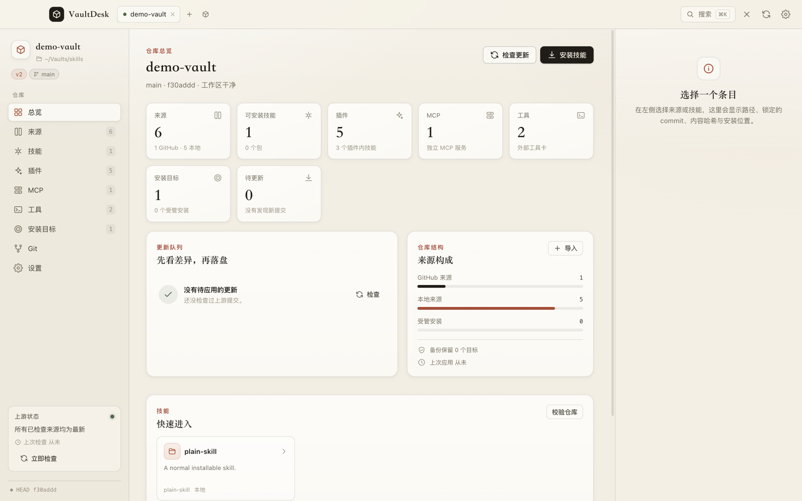
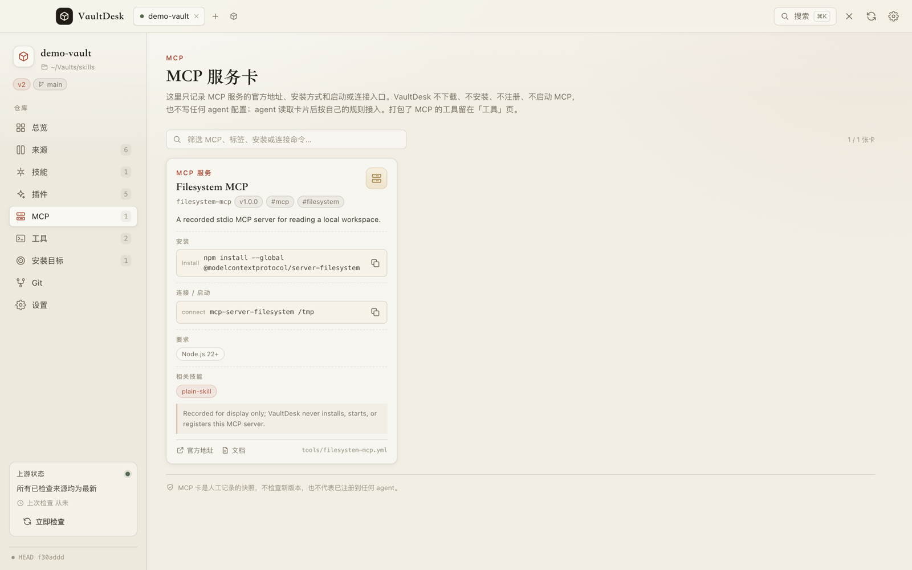
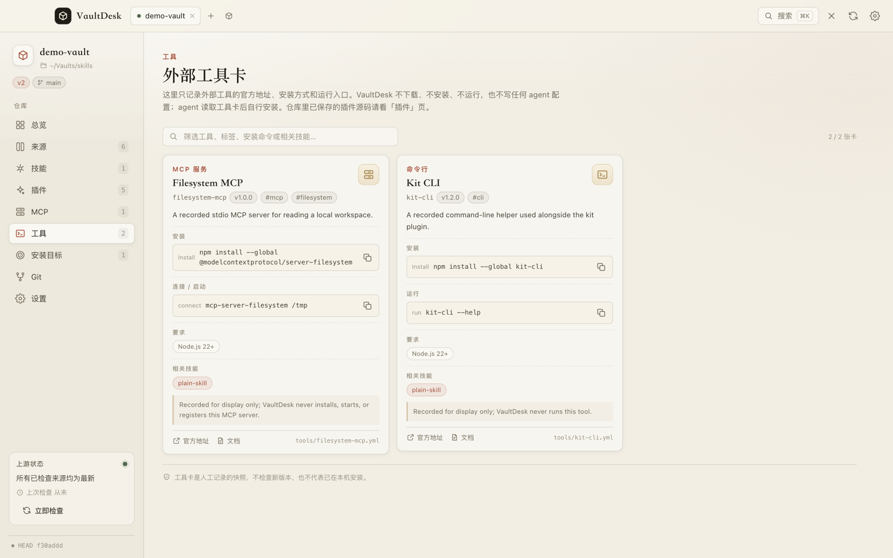

<p align="center">
  
</p>

<h1 align="center">VaultDesk</h1>

<p align="center">
  <strong>A local-first desktop app and CLI for Git-backed agent skill vaults.</strong><br>
  Browse skills, review upstream diffs, install rebuildable copies, and record plugins and MCP servers without running them.
</p>

<p align="center">
  <a href="https://github.com/coderWang404/vaultdesk/actions/workflows/ci.yml"></a>
  <a href="LICENSE"></a>
  
  
  
</p>

<p align="center">
  
</p>

> [!NOTE]
> 1.0.0 is usable from source. The tool-card and MCP record layer is on `main` but is not part of a tagged release. There is no notarized build, GitHub Release, Homebrew formula, or npm package yet.

## Contents

- [Why VaultDesk](#why-vaultdesk)
- [What it manages](#what-it-manages)
- [Desktop app](#desktop-app)
- [Screenshots](#screenshots)
- [Install](#install)
- [Quick start](#quick-start)
- [Reviewing updates](#reviewing-updates)
- [CLI](#cli)
- [Tool cards and MCP](#tool-cards-and-mcp)
- [Vault layout](#vault-layout)
- [Architecture](#architecture)
- [Safety model](#safety-model)
- [Testing](#testing)
- [Status](#status)
- [Contributing](#contributing)
- [License](#license)

## Why VaultDesk

Agent skills are easy to write and hard to keep track of. They get copied into several agent directories, edited in place, and slowly drift away from the repository they came from. VaultDesk gives the repository back control: the vault is the source of truth, and every install destination is a disposable copy that can be verified or rebuilt.

The project is built on four rules:

1. **The repository is the source of truth.** Install destinations are artifacts, not the primary copy.
2. **Review before write.** Network fetches happen outside the vault, and every write has a preview.
3. **Third-party stays third-party.** Plugins and external tools are stored or recorded, never executed or installed by VaultDesk.
4. **One core, two surfaces.** The desktop app and CLI share the same TypeScript core, rules, and JSON contract.

VaultDesk is for people who run more than one coding agent and maintain their own skill library. It is not a marketplace, an agent runtime, or a plugin installer.

## What it manages

| Layer | Stored as | VaultDesk does | VaultDesk never does |
| --- | --- | --- | --- |
| Skills | `skills/`, `packages/` | Build, install, verify, restore, edit local skills, fork GitHub skills | Edit GitHub originals before a fork |
| Plugins | `plugins/`, `third_party/` | Register whole roots, validate assets, show diffs, update with review | Install, enable, adapt, or execute hooks, scripts, or MCP servers |
| Tool cards | `tools/<name>.yml` | Record official links, install methods, run entry points; display them and build an index | Download, install, run, or version-check the tool; write agent configuration |
| Install targets | `vault.yml`, `.vault-managed` markers | Classify slots, back up, copy, verify, restore | Delete unmanaged content |

The three asset types have deliberately different boundaries:

- **Skills** are fully managed by VaultDesk. They are built into `build/skills/` and copied into explicit install targets.
- **Plugins** are registered as `shape: plugin` sources. VaultDesk stores the whole root, validates it, and tracks changes, but the agent installs and adapts the plugin itself.
- **Tool cards** are records for things VaultDesk does not host at all: MCP servers, CLIs, desktop tools, and multi-tool suites such as REA. Agents read the card and install the tool from the official source.

## Desktop app

The desktop app is an Electron + React shell around the shared core. It provides:

- Multiple vaults in tabs, each with its own lock and state
- Overview, sources, skills, plugins, MCP, tools, targets, Git, and settings pages
- `Cmd+K` metadata search across open vaults
- Upstream checks, per-file diffs, and review-before-apply updates
- Import flows for local folders, GitHub repositories, skills, packages, and plugin roots
- Installation previews, slot classification, timestamped backups, verification, and restore
- Explicit Git commit and push limited to the paths VaultDesk changed
- Read-only record pages for plugins, tool cards, and MCP servers

The desktop UI copy is currently Chinese. The CLI output, JSON envelopes, and public documentation are English.

## Screenshots

| MCP records | External tool cards |
| --- | --- |
|  |  |

Both screenshots use a demo vault built from the public fixtures. No personal skill content is included.

## Install

### Requirements

- **Desktop:** macOS 13 or newer, Apple Silicon or Intel
- **Build:** Node.js 22+, pnpm 11.5.2, Git on `PATH`
- **CLI:** Node.js 22+; CI also builds and tests on Ubuntu

The desktop app has no published binary yet. The CLI is not on npm. Both are built from this repository.

### Desktop from source

```bash
git clone https://github.com/coderWang404/vaultdesk.git
cd vaultdesk
corepack enable
pnpm install
pnpm dev
```

To package an ad-hoc signed DMG:

```bash
pnpm package:mac
# release/VaultDesk-1.0.0-<arch>.dmg
```

The build is ad-hoc signed and not notarized. On first launch, right-click the app and choose **Open**, or allow it in **System Settings → Privacy & Security**.

### CLI from source

```bash
pnpm build:packages
ln -sf "$PWD/packages/cli/dist/index.js" ~/.local/bin/vaultdesk
vaultdesk --help
```

Make sure `~/.local/bin` is on your `PATH`. You can also run the CLI directly with `node packages/cli/dist/index.js ...`.

## Quick start

Create a vault, import a local skill, build it, and install it into an agent directory:

```bash
export VAULT=~/Vaults/skills

vaultdesk vault init "$VAULT" --git --name skills --yes
vaultdesk source add ~/src/my-skill --vault "$VAULT" --yes
vaultdesk vault validate --vault "$VAULT"
vaultdesk build --vault "$VAULT" --yes
vaultdesk target install my-skill --vault "$VAULT" \
  --dest ~/.claude/skills --id claude-code --yes
vaultdesk target verify claude-code --vault "$VAULT"
```

`~/src/my-skill` is a directory containing a `SKILL.md`. The `target install` command creates or reuses the target registered as `claude-code`; adjust the destination to the directory your agent reads.

Open the desktop app and add the same vault with the `+` button. The app and CLI can work on the same vault, but only one desktop instance should hold a vault open at a time.

## Reviewing updates

```bash
vaultdesk source check --vault "$VAULT"
vaultdesk source diff some-source --vault "$VAULT"
vaultdesk source update some-source --vault "$VAULT" --yes
```

`source check` only fetches into the cache and does not write tracked vault files. `source diff` shows a per-file unified diff. `source update` previews first and applies only with `--yes`; the desktop app shows the same preview behind a confirmation dialog.

For plugins, an update refreshes the stored plugin root and its lock entry. It does not touch the copy an agent may have installed, and a pure plugin update does not rebuild skills or reinstall targets.

## CLI

```text
vaultdesk <group> <action> [arguments] [options]
```

| Group | Actions |
| --- | --- |
| `vault` | `status`, `validate`, `init`, `migrate` |
| `source` | `list`, `show`, `check`, `diff`, `update`, `add`, `remove`, `fork` |
| `plugin` | `list`, `show` |
| `tool` | `list`, `show`, `add` |
| `target` | `list`, `install`, `remove`, `verify`, `restore` |
| `build` | Rebuild `build/skills/` and `build/tools.json` |
| `presets` | `list`, `verify` |
| `agent` | `skill` |
| `git` | `status`, `commit`, `push` |

Read commands never write. Write commands print a preview unless `--yes` is passed. Global options are `--vault <path>`, `--json`, `--yes`, `--help`, and `--version`.

Every command supports `--json`, which returns one envelope on stdout:

```json
{
  "schema": 1,
  "command": "tool.list",
  "data": [],
  "warnings": [],
  "errors": []
}
```

| Exit code | Meaning |
| --- | --- |
| `0` | Success |
| `1` | Operation failed |
| `2` | Usage or validation error |
| `3` | Network or authentication error |

Interactive prompts go to stderr, so stdout remains parseable. GitHub operations use `GIT_TERMINAL_PROMPT=0` and fail instead of hanging on credentials.

## Tool cards and MCP

A tool card records an external tool. It is not a source and is not installed by VaultDesk.

```yaml
schema: 1
name: fetch-mcp
kind: mcp
title: Fetch MCP
summary: A recorded Python MCP server that fetches and converts web pages.
homepage: https://github.com/modelcontextprotocol/servers
docs: https://github.com/modelcontextprotocol/servers/tree/main/src/fetch
install:
  - label: Install
    command: uvx mcp-server-fetch
run: uvx mcp-server-fetch
requirements:
  - uv
tags: [mcp, fetch]
notes: Recorded for display only; VaultDesk never installs, starts, or registers this MCP server.
```

`kind` describes the distribution form. Protocol information belongs in `tags`.

| `kind` | Use for | Example |
| --- | --- | --- |
| `plugin` | Multi-tool suites distributed as agent plugins | REA |
| `mcp` | MCP servers | Filesystem, fetch |
| `cli` | Standalone command-line tools | A build helper |
| `app` | Desktop or GUI tools | A local editor |

Cards live in `tools/<name>.yml`. The desktop **Tools** page shows all of them, and the **MCP** page filters to `kind: mcp`. The CLI exposes the same data:

```bash
vaultdesk tool list --vault "$VAULT" --json
vaultdesk tool list --vault "$VAULT" --kind mcp --json
vaultdesk tool show fetch-mcp --vault "$VAULT"
```

Record a card with the CLI. The command previews first and writes only with `--yes`:

```bash
vaultdesk tool add fetch-mcp --vault "$VAULT" --kind mcp \
  --title "Fetch MCP" \
  --summary "A recorded Python MCP server that fetches and converts web pages." \
  --homepage https://github.com/modelcontextprotocol/servers \
  --docs https://github.com/modelcontextprotocol/servers/tree/main/src/fetch \
  --install-command "install=uvx mcp-server-fetch" \
  --run "uvx mcp-server-fetch" --requirement uv --tag mcp --tag fetch --yes
```

`vaultdesk build` writes `build/tools.json`, a deterministic index of all cards without timestamps. Agents read either the YAML, the JSON index, or `tool show --json`, then use their own installation and registration rules.

VaultDesk does not check the recorded version for updates, does not start or health-check an MCP server, and does not write MCP configuration into any agent. Never put tokens, keys, or private URLs in a card.

## Vault layout

VaultDesk supports the v2 layout and can open, validate, and migrate v1 vaults.

```text
vault.yml                  # vault metadata, defaults, install targets
vault.lock                 # upstream commits and content hashes
sources/<name>.yml         # source metadata: origin, ref, update mode
skills/<name>/SKILL.md     # local skills
packages/<pkg>/skills/...  # imported multi-skill packages
plugins/<name>/            # whole plugin roots
tools/<name>.yml           # record-only external tool cards
third_party/<name>/        # pristine copy of GitHub plugin roots
build/skills/<name>/       # generated skill output
build/tools.json           # generated tool index
.vault/state.json          # local machine state, gitignored
```

VaultDesk writes a `.vault-managed` marker into every install slot it owns. That marker is how it distinguishes its own copies from unmanaged directories, and why an unmanaged directory is moved to a timestamped backup instead of being overwritten.

## Architecture

```text
┌──────────────────────────────┐
│ Desktop renderer (React)     │  no Node integration
└──────────────┬───────────────┘
               │ typed IPC, validated with zod
┌──────────────▼───────────────┐
│ Electron main process        │  filesystem, Git, network
└──────────────┬───────────────┘
               │
┌──────────────▼───────────────┐
│ packages/core                │  vault model, import, plugins,
│                              │  tool cards, search, build, install
└──────────────┬───────────────┘
               │
┌──────────────▼───────────────┐
│ packages/schema              │  zod schemas and IPC contracts
└──────────────────────────────┘
               ▲
               │
┌──────────────┴───────────────┐
│ packages/cli                 │  vaultdesk CLI, JSON envelopes
└──────────────────────────────┘
```

Repository layout:

| Path | Purpose |
| --- | --- |
| `apps/desktop/` | Electron app, React renderer, preload bridge |
| `packages/cli/` | `vaultdesk` command-line interface |
| `packages/core/` | Vault model, import, plugins, tool cards, build, install, Git |
| `packages/schema/` | Zod schemas and shared IPC types |
| `agent-skill/vaultdesk/` | Agent skill bundled with the app and CLI |
| `fixtures/` | Public v1 and v2 test vaults |
| `tests/` | Vitest integration tests and Playwright Electron E2E |
| `docs/` | Design, plugin rules, release notes, and interop notes |

The renderer has no Node access. The main process owns all filesystem, Git, and network work behind zod-validated IPC. VaultDesk does not start a local HTTP server. External links open in the system browser.

## Safety model

- **Preview and confirm.** Every write shows a preview first. The CLI requires `--yes`; the app requires a confirmation dialog.
- **Fetch outside the vault.** Upstream data lands in the cache first. Nothing is written to the vault until the preview is accepted.
- **GitHub content is read-only until forked.** GitHub-origin skills cannot be edited in place.
- **Plugins are stored, not executed.** Hooks, scripts, commands, and MCP servers inside a plugin root are never run. VaultDesk does not generate marketplace or adapter manifests.
- **Tool cards are records.** No download, installation, execution, version check, or agent registration.
- **Unmanaged directories survive.** They are moved to a timestamped backup, and VaultDesk keeps the ten most recent snapshots per target.
- **Git staging is explicit.** VaultDesk commits only the paths it changed. It never runs `git add -A` and refuses paths outside the vault or under `.git`.
- **Verification has a defined scope.** `target verify` proves that expected files exist and hashes match. It does not prove that an agent loaded a skill.
- **Secrets stay out.** Do not store tokens, keys, or private URLs in a vault, a plugin record, or a tool card.

## Testing

```bash
pnpm typecheck
pnpm test             # 66 tests across 14 files
pnpm test:e2e         # CLI + desktop Playwright suites
pnpm test:e2e:cli
pnpm test:e2e:desktop
pnpm test:e2e:dmg     # package the DMG, mount it, and verify the app
```

The E2E suites launch the real Electron app and the built CLI against isolated temporary vaults, local bare Git remotes, and a local HTTP server for auth and network exit codes. They never touch a real vault. The accessibility scenario scans nine views with axe-core. Failed runs keep their workspace under `$TMPDIR` and print the path.

CI runs typecheck, unit and integration tests, and builds on macOS and Ubuntu. The macOS job also runs the Electron smoke test, uploads a screenshot, packages the DMG, and uploads it as a build artifact.

See [tests/e2e/README.md](tests/e2e/README.md) for the scenario matrix and deliberate coverage limits.

## Status

| Area | State |
| --- | --- |
| Desktop app and CLI | 1.0.0, usable from source |
| Tool cards and MCP view | Implemented on `main`, not in a tagged release |
| DMG | Builds locally, ad-hoc signed, not notarized |
| GitHub Release / Homebrew / npm | Not published |
| Auto-update | Not implemented |
| Windows and Linux desktop | Not planned for 1.0 |

The desktop app is macOS-only at 1.0.0. The CLI is tested on macOS and Ubuntu.

## Contributing

Issues and pull requests are welcome. Before changing behavior, read:

- [docs/DESIGN.md](docs/DESIGN.md) for the data model, CLI contract, and safety rules
- [docs/PLUGINS.md](docs/PLUGINS.md) for plugin detection, validation, and update rules
- [agent-skill/vaultdesk/SKILL.md](agent-skill/vaultdesk/SKILL.md) for the agent-facing contract

Keep the boundary intact. VaultDesk stores, validates, records, and displays. It does not install or execute plugins, tools, or MCP servers, does not generate marketplace or adapter manifests, and does not write agent configuration.

```bash
pnpm install
pnpm typecheck
pnpm test
pnpm test:e2e
```

Small, focused pull requests with a test that covers the change are easiest to review.

## License

Apache-2.0. See [LICENSE](LICENSE) and [NOTICE](NOTICE).

This repository contains the tool, tests, fixtures, and public documentation. It does not contain the maintainer's personal vault or third-party skill content.

<p align="center"><sub>Copyright © 2026 coderWang404</sub></p>
